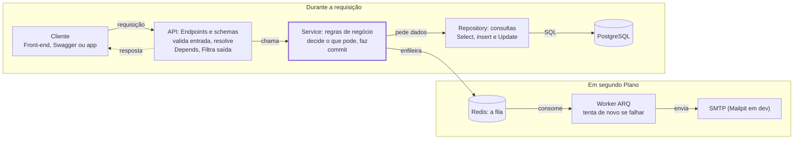
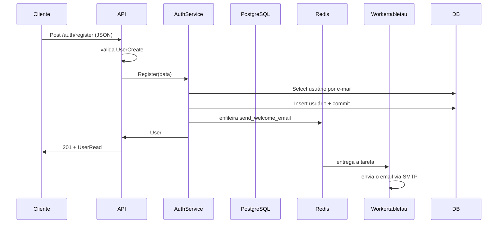

### Capítulo 1: Criando projeto com o **uv**
acessando o local utilizado para guardar seu projeto execute o comando para a inicialização do projeto

```bash
uv init fastapi-aisiki
```
Assim será criada a estrutura abaixo:
```text
.
├── .git/                       # Metadados e histórico do Git
├── .gitignore                  # Arquivos e pastas que o Git deve ignorar
├── pyproject.toml              # Configurações e metadados do projeto Python
├── .python-version             # Versão do Python desejada para o projeto
├── README.md                   # Documentação inicial do projeto
├── src/                        # Diretório que contém o código-fonte
│   └── fastapi_aisili/         # Pacote Python da aplicação
│       └── __init__.py         # Inicialização e identificação do pacote
└── uv.lock                     # Versões exatas das dependências resolvidas
```
### Capítulo 2: o pyproject.toml e as ferramentas
É um dos arquivos mais importantes do projeto.
Ele concentra metadados, dependências e configurações de ferramentas utilizadas no desenvolvimento.
Por exemplo:
```toml
[project]
name = "fastapi-aisiki"
version = "0.1.0"
description = "API profissional com FastAPI, JWT, PostgreSQL, Redis (filas) e Docker"
readme = "README.md"
authors = [
    { name = "David Luis da Silva", email = "tecnicoroot@gmail.com" }
]

requires-python = ">=3.12"
dependencies = [
    "fastapi>=0.115.0",
    "uvicorn[standard]>=0.32.0",
    "pydantic[email]>=2.9.0",
    "pydantic-settings>=2.6.0",
    "sqlalchemy[asyncio]>=2.0.36",
    "asyncpg>=0.30.0",
    "alembic>=1.14.0",
    "pyjwt>=2.10.0",
    "pwdlib[argon2]>=0.2.1",
    "python-multipart>=0.0.18",
    "arq>=0.26.1",
    "aiosmtplib>=3.0.2",
]

[dependency-groups]
dev = [
    "pytest>=8.3.0",
    "pytest-asyncio>=0.24.0",
    "pytest-cov>=6.0.0",
    "httpx>=0.28.0",
    "mypy>=1.13.0",
    "ruff>=0.8.0",
    "pre-commit>=4.0.0",
]

# ---------------------------------------------------------------- Ruff
[tool.ruff]
line-length = 100
target-version = "py312"
extend-exclude = ["alembic/versions"]

[tool.ruff.lint]
select = [
    "E", "W",   # pycodestyle
    "F",        # pyflakes
    "I",        # isort
    "B",        # bugbear
    "UP",       # pyupgrade
    "N",        # pep8-naming
    "S",        # bandit (segurança)
    "C4",       # comprehensions
    "SIM",      # simplify
    "RUF",      # regras do ruff
    "ASYNC",    # boas práticas async
    "PT",       # pytest
    "T20",      # proíbe print()
]

[tool.ruff.lint.per-file-ignores]
"tests/**" = ["S101", "S105", "S106"]

[tool.ruff.format]
quote-style = "double"

# ---------------------------------------------------------------- Mypy
[tool.mypy]
python_version = "3.12"
strict = true
plugins = ["pydantic.mypy"]
exclude = ["alembic/versions/"]

[[tool.mypy.overrides]]
module = ["asyncpg", "asyncpg.*"]
ignore_missing_imports = true

[tool.pydantic-mypy]
init_forbid_extra = true
init_typed = true
warn_required_dynamic_aliases = true

# ---------------------------------------------------------------- Pytest
[tool.pytest.ini_options]
testpaths = ["tests"]
asyncio_mode = "auto"
asyncio_default_fixture_loop_scope = "function"
addopts = "-ra --strict-markers"

[tool.coverage.run]
source = ["app"]
concurrency = ["greenlet", "thread"]
omit = ["app/scripts/*", "app/worker/settings.py"]

[tool.coverage.report]
show_missing = true
skip_covered = true


```
### Capítulo 3: Antes de começar a codificatr...
Antes de iniciar a codificação vamos entender um pouco melhor as camadas e o fluxo de nossa aplicação.

|Camada |Pasta |Responsabilidade |Não deve saber de...|
|--|--|--|--|
|API(endpoints)|app/api/ Receber HTTP, validar entrada,|devolver resposta|SQL, regras de negócio|
|Schemas |app/schemas/ |Formato dos dados que entram esaem (contratos)|Banco de dados|
|Services |app/services/ |Regras de negócio ("e-mail nãopode repetir")|HTTP, status code|
|Repositories |app/repositories/ |Consultas ao banco (SELECT, INSERT...)|Regras de negócio|
|Models |app/models/ |Tabelas do banco como classes Python|Tudo acima|
|Core |app/core/ |Configuração, segurança,exceções, fila |—|
|Worker |app/worker/ |Tarefas executadas em segundo plano |HTTP|






> Por que isso importa? Imagine que amanhã você precise criar usuários também por um comando de terminal. Como a regra "e-mail não pode repetir" está no service, e não no endpoint, você reaproveita o AuthService sem duplicar nada.
#### O caminho de uma requisição
Quando alguém chama POST /api/v1/auth/register , acontece esta sequência:
> 1. O FastAPI recebe o JSON e o converte num UserCreate (schema). Se o e-mail for
inválido, ele já devolve 422 sem chegar ao seu código.
> 2. O endpoint register pede ao FastAPI um AuthService pronto (injeção de
dependências).
> 3. O service verifica se o e-mail já existe usando o UserRepository .
> 4. O repository executa o SELECT usando a sessão do SQLAlchemy.
> 5. O service cria o User (model), salva com commit() e coloca uma tarefa "enviar e-mail
de boas-vindas" na fila do Redis.
> 6. O endpoint devolve o User , que o FastAPI converte em UserRead (schema de saída),
escondendo a senha.
> 7. Em paralelo, o worker pega a tarefa da fila e envia o e-mail, sem atrasar a resposta. Camada Pasta Responsabilidade Não deve saber de...

### Capítulo 5: Bibliotecas que utilizaremos 
Pode ser necessário instalar a versão correta do python:
```bash
uv python install 3.12
uv python pin 3.12
uv sync
```

|Biblioteca |Para que serve|
|--|--|
|fastapi |Framework web: rotas, validação, documentação automática|
|uvicorn[standard] |ServidorASGI que executa a aplicação|
|pydantic[email] / pydantic-settings |Validação de dados e leitura do .env |
|sqlalchemy[asyncio] + asyncpg | ORM e driver assíncrono do PostgreSQL
|alembic |Migrations (versionamento do banco)|
|pyjwt |Criar e validar tokens JWT|
|pwdlib[argon2]| Hash seguro de senhas com Argon2|
|python-multipart |Permite receber formulários (usado no loginOAuth2)|
|arq |Fila de tarefas assíncrona sobre Redis|
|aiosmtplib |Envio de e-mail assíncrono|

### Capítulo 6: Git Cada prefixo tem um papel: Mensagens no commit

Tipos de commit mais utilizados
O Conventional Commits define uma convenção para classificar as alterações.
|Tipo |Quando utilizar| Exemplo|
|--|--|--|
|feat |Adicionar uma funcionalidade	|feat(api): adiciona rota de usuários|
|fix |Corrigir um defeito |fix(api): corrige validação de email|
|docs |Alterar documentação	|docs(readme): documenta instalação do projeto|
|style |Alterações de formatação que não mudam a lógica	|style(api): ajusta formatação do código|
|refactor |Reorganizar o código sem alterar seu comportamento externo |refactor(services): simplifica validação de usuários|
|test |Adicionar ou modificar testes |test(api): adiciona testes para rota de usuários|
|build |Alterar dependências ou o sistema de build |build(deps): adiciona dependência do fastapi|
|ci	|Alterar configurações de integração contínua |ci(github): configura execução dos testes|
|perf |Melhorar o desempenho |perf(api): reduz consultas ao banco de dados|
|chore |Outras tarefas de manutenção |chore(git): atualiza arquivos ignorados|

### Capítulo 4: configuração com pydantic-settings e o .env