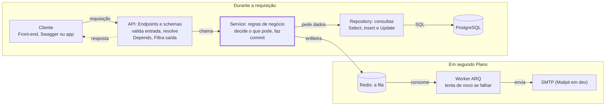
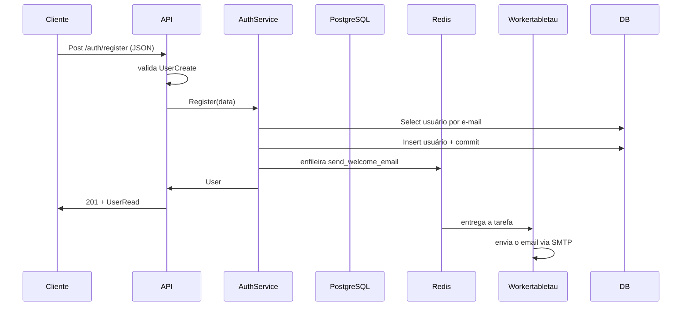

## Guia passo a passo

### Índice

- [Capítulo 1](#capitulo-1)
- [Capítulo 10](#capitulo-10)

### Capítulo 1: Criando projeto com o **uv**

Acessando o local utilizado para guardar seu projeto execute o comando para a inicialização do projeto

```bash
uv init fastapi-aisiki
```

Assim será criada a estrutura abaixo:

```text
.
├── .git/                       # Metadados e histórico do Git
├── .gitignore                  # Arquivos e pastas que o Git deve ignorar
├── pyproject.toml              # Configurações e metadados do projeto Python
├── .python-version             # Versão do Python desejada para o projeto
├── README.md                   # Documentação inicial do projeto
├── src/                        # Diretório que contém o código-fonte
│   └── fastapi_aisili/         # Pacote Python da aplicação
│       └── __init__.py         # Inicialização e identificação do pacote
└── uv.lock                     # Versões exatas das dependências resolvidas
```

### Capítulo 2: o pyproject.toml e as ferramentas

É um dos arquivos mais importantes do projeto.
Ele concentra metadados, dependências e configurações de ferramentas utilizadas no desenvolvimento.
Por exemplo:

```toml
[project]
name = "fastapi-aisiki"
version = "0.1.0"
description = "API profissional com FastAPI, JWT, PostgreSQL, Redis (filas) e Docker"
readme = "README.md"
authors = [
    { name = "David Luis da Silva", email = "tecnicoroot@gmail.com" }
]

requires-python = ">=3.12"
dependencies = [
    "fastapi>=0.115.0",
    "uvicorn[standard]>=0.32.0",
    "pydantic[email]>=2.9.0",
    "pydantic-settings>=2.6.0",
    "sqlalchemy[asyncio]>=2.0.36",
    "asyncpg>=0.30.0",
    "alembic>=1.14.0",
    "pyjwt>=2.10.0",
    "pwdlib[argon2]>=0.2.1",
    "python-multipart>=0.0.18",
    "arq>=0.26.1",
    "aiosmtplib>=3.0.2",
]

[dependency-groups]
dev = [
    "pytest>=8.3.0",
    "pytest-asyncio>=0.24.0",
    "pytest-cov>=6.0.0",
    "httpx>=0.28.0",
    "mypy>=1.13.0",
    "ruff>=0.8.0",
    "pre-commit>=4.0.0",
]

# ---------------------------------------------------------------- Ruff
[tool.ruff]
line-length = 100
target-version = "py312"
extend-exclude = ["alembic/versions"]

[tool.ruff.lint]
select = [
    "E", "W",   # pycodestyle
    "F",        # pyflakes
    "I",        # isort
    "B",        # bugbear
    "UP",       # pyupgrade
    "N",        # pep8-naming
    "S",        # bandit (segurança)
    "C4",       # comprehensions
    "SIM",      # simplify
    "RUF",      # regras do ruff
    "ASYNC",    # boas práticas async
    "PT",       # pytest
    "T20",      # proíbe print()
]

[tool.ruff.lint.per-file-ignores]
"tests/**" = ["S101", "S105", "S106"]

[tool.ruff.format]
quote-style = "double"

# ---------------------------------------------------------------- Mypy
[tool.mypy]
python_version = "3.12"
strict = true
plugins = ["pydantic.mypy"]
exclude = ["alembic/versions/"]

[[tool.mypy.overrides]]
module = ["asyncpg", "asyncpg.*"]
ignore_missing_imports = true

[tool.pydantic-mypy]
init_forbid_extra = true
init_typed = true
warn_required_dynamic_aliases = true

# ---------------------------------------------------------------- Pytest
[tool.pytest.ini_options]
testpaths = ["tests"]
asyncio_mode = "auto"
asyncio_default_fixture_loop_scope = "function"
addopts = "-ra --strict-markers"

[tool.coverage.run]
source = ["app"]
concurrency = ["greenlet", "thread"]
omit = ["app/scripts/*", "app/worker/settings.py"]

[tool.coverage.report]
show_missing = true
skip_covered = true
```

### Capítulo 3: Antes de começar a codificatr

Antes de iniciar a codificação vamos entender um pouco melhor as camadas e o fluxo de nossa aplicação.

|Camada|Pasta|Responsabilidade|Não deve saber de...|
|--|--|--|--|
|API(endpoints)|app/api/ Receber HTTP, validar entrada,|devolver resposta|SQL, regras de negócio|
|Schemas|app/schemas/|Formato dos dados que entram esaem (contratos)|Banco de dados|
|Services|app/services/|Regras de negócio ("e-mail nãopode repetir")|HTTP, status code|
|Repositories|app/repositories/|Consultas ao banco (SELECT, INSERT...)|Regras de negócio|
|Models|app/models/|Tabelas do banco como classes Python|Tudo acima|
|Core|app/core/|Configuração, segurança,exceções, fila|—|
|Worker|app/worker/|Tarefas executadas em segundo plano|HTTP|





> Por que isso importa? Imagine que amanhã você precise criar usuários também por um comando de terminal. Como a regra "e-mail não pode repetir" está no service, e não no endpoint, você reaproveita o AuthService sem duplicar nada.

#### O caminho de uma requisição

Quando alguém chama POST /api/v1/auth/register , acontece esta sequência:

> 1. O FastAPI recebe o JSON e o converte num UserCreate (schema). Se o e-mail for
inválido, ele já devolve 422 sem chegar ao seu código.
> 2. O endpoint register pede ao FastAPI um AuthService pronto (injeção de
dependências).
> 3. O service verifica se o e-mail já existe usando o UserRepository .
> 4. O repository executa o SELECT usando a sessão do SQLAlchemy.
> 5. O service cria o User (model), salva com commit() e coloca uma tarefa "enviar e-mail
de boas-vindas" na fila do Redis.
> 6. O endpoint devolve o User , que o FastAPI converte em UserRead (schema de saída),
escondendo a senha.
> 7. Em paralelo, o worker pega a tarefa da fila e envia o e-mail, sem atrasar a resposta. Camada Pasta Responsabilidade Não deve saber de...

### Capítulo 4: Bibliotecas que utilizaremos

Pode ser necessário instalar a versão correta do python:

```bash
uv python install 3.12
uv python pin 3.12
uv sync
```

|Biblioteca|Para que serve|
|--|--|
|fastapi|Framework web: rotas, validação, documentação automática|
|uvicorn[standard]|ServidorASGI que executa a aplicação|
|pydantic[email] / pydantic-settings|Validação de dados e leitura do .env|
|sqlalchemy[asyncio] + asyncpg|ORM e driver assíncrono do PostgreSQL
|alembic|Migrations (versionamento do banco)|
|pyjwt|Criar e validar tokens JWT|
|pwdlib[argon2]|Hash seguro de senhas com Argon2|
|python-multipart|Permite receber formulários (usado no loginOAuth2)|
|arq|Fila de tarefas assíncrona sobre Redis|
|aiosmtplib|Envio de e-mail assíncrono|

### Capítulo 5: Git Cada prefixo tem um papel: Mensagens no commit

Tipos de commit mais utilizados
O Conventional Commits define uma convenção para classificar as alterações.

|Tipo|Quando utilizar|Exemplo|
|--|--|--|
|feat|Adicionar uma funcionalidade |feat(api): adiciona rota de usuários|
|fix|Corrigir um defeito|fix(api): corrige validação de email|
|docs|Alterar documentação |docs(readme): documenta instalação do projeto|
|style|Alterações de formatação que não mudam a lógica |style(api): ajusta formatação do código|
|refactor|Reorganizar o código sem alterar seu comportamento externo|refactor(services): simplifica validação de usuários|
|test|Adicionar ou modificar testes|test(api): adiciona testes para rota de usuários|
|build|Alterar dependências ou o sistema de build|build(deps): adiciona dependência do fastapi|
|ci |Alterar configurações de integração contínua|ci(github): configura execução dos testes|
|perf|Melhorar o desempenho|perf(api): reduz consultas ao banco de dados|
|chore|Outras tarefas de manutenção|chore(git): atualiza arquivos ignorados|

Agora neste ponto vou fazer o primeiro commit

vamos utilizar o seguinte texto:

```text
chore(project): configura estrutura inicial do projeto
- pyproject.toml
- README.md
```

### Capítulo 6: configuração com pydantic-settings e o .env

Arquivo: app/core/config.py . A regra de ouro é: nada que muda entre ambientes fica
no código. Senha do banco, chave do JWT, endereço do Redis vêm de variáveis de
ambiente, e o arquivo .env é só uma forma prática de defini-las em desenvolvimento.

```text
...
├── src/                        # Diretório que contém o código-fonte
│   └── fastapi_aisili/         # Pacote Python da aplicação
│       ├──__init__.py
        └── core/ 
            └── config.py       # Inicialização e identificação do pacote
...
```

*Settings* herda de *BaseSettings* . Isso significa que, ao fazer Settings() , o Pydantic
procura cada atributo como variável de ambiente com o **mesmo nome**. A ordem de prioridade
é: variável de ambiente real primeiro, depois o arquivo .env , depois o valor padrão
escrito na classe.

#### Repare nos detalhes

- **Tipos convertem e validam**. POSTGRES_PORT: int faz o texto "5432" do .env virar o número 5432. Se alguém escrever POSTGRES_PORT=abc , a aplicação nem sobe, com uma mensagem clara.
- **Literal[...]** só aceita aqueles valores exatos. Um erro de digitação como ENVIRONMENT=producton é barrado na hora.
- **SECRET_KEY** não tem valor padrão. Por isso ela é obrigatória: se faltar, a aplicação
recusa iniciar. Isso evita subir em produção com uma chave de exemplo.
- **SecretStr** esconde o valor quando impresso. print(settings.SECRET_KEY) mostra
********** , e logs não vazam senhas por acidente. Para usar o valor real, chama-se
.get_secret_value() .
- **extra="ignore"** permite que o .env tenha variáveis que a classe não usa (como
INSTALL_DEV , usada pelo Docker).
- **CORS_ORIGINS: list[str]** é lida como JSON: no .env escreve-se CORS_ORIGINS=
["http://localhost:3000"] .

#### Validação entre campos

```python
@model_validator(mode="after")
def _validate_production(self) -> Self:
    if self.ENVIRONMENT == "production" and
    len(self.SECRET_KEY.get_secret_value()) < 32:

raise ValueError("SECRET_KEY deve ter pelo menos 32 caracteres em produção.")
return self

```

Um model_validator com mode="after" roda depois que todos os campos foram lidos e
validados individualmente. Ele serve para regras que envolvem mais de um campo, como
"em produção, a chave precisa ser longa". Self é o tipo da própria classe.

#### Propriedades calculadas

```python
@property
def database_url(self) -> str:
    return URL.create(
        drivername="postgresql+asyncpg",
        username=self.POSTGRES_USER,
        password=self.POSTGRES_PASSWORD.get_secret_value(),
        host=self.POSTGRES_HOST,
        ...
        ).render_as_string(hide_password=False)

```

Em vez de pedir a URL inteira no .env , montamos a partir das partes. O URL.create do SQLAlchemy cuida de escapar caracteres especiais: se a senha tiver @ ou / , uma
concatenação manual com f-string quebraria a URL. O prefixo postgresql+asyncpg diz
ao SQLAlchemy qual driver usar.

#### Uma instância só: lru_cache

```python
@lru_cache
def get_settings() -> Settings:
    return Settings()
settings = get_settings()

```

Ler o .env e validar tudo tem custo, e não faz sentido repetir. O **@lru_cache** memoriza o retorno: a primeira chamada cria o objeto, as seguintes devolvem o mesmo. O resto do projeto importa settings diretamente.
Um detalhe importante para os testes: como settings é criado no momento do import,o conftest.py precisa alterar os.environ antes de importar qualquer coisa de app.

O .env.example

O .env real fica fora do Git (está no .gitignore ), porque contém segredos. O
.env.example vai para o Git como modelo, com valores falsos e comentários. Quem clona o projeto faz cp .env.example .env e ajusta.
Verificação: se o .env tem POSTGRES_HOST=localhost e o docker-compose.yml define
POSTGRES_HOST: db , qual valor a aplicação usa dentro do container? Por quê?

### Capitulo 7: Banco de Dados assincrono

```text
...
├── src/                        # Diretório que contém o código-fonte
│   └── fastapi_aisili/         # Pacote Python da aplicação
│       ├──__init__.py
        └── db/ 
            ├── base.py  
            └── session.py
...
```

Arquivos: app/db/base.py e app/db/session.py . Aqui definimos a base de todos os models e a forma como a aplicação abre conexões com o PostgreSQL.

#### Antes: o que é "assíncrono"?

Uma consulta ao banco leva alguns milissegundos, e nesse tempo o processador fica
parado esperando a resposta pela rede. Com código síncrono, o servidor fica preso nessa
espera. Com async / await , enquanto uma requisição espera o banco, o mesmo processo
atende outras.
A regra prática: toda operação que espera algo externo (banco, Redis, SMTP, HTTP) é
chamada com await , e só pode ficar dentro de uma função async def . Por isso usamos
bibliotecas assíncronas: asyncpg em vez de psycopg2 , aiosmtplib em vez de smtplib .

Todo model herda de Base . O DeclarativeBase é o mecanismo do SQLAlchemy 2.0 que
transforma uma classe Python em tabela. O metadata é o "catálogo" onde ficam
registradas todas as tabelas; o Alembic lê esse catálogo para gerar migrations.
A naming convention dá nomes previsíveis às constraints. Sem ela, o PostgreSQL inventa
nomes como users_email_key , e para remover essa constraint numa migration futura
você precisaria saber esse nome. Com ela, o nome é sempre uq_users_email .
O type_annotation_map diz: "todo campo anotado como datetime vira TIMESTAMP WITH
TIME ZONE ". Guardar datas com fuso evita o clássico bug de horário que muda entre
servidor e cliente.

#### Mixins: código reutilizável entre models

```python
class UUIDPrimaryKeyMixin:
    id: Mapped[uuid.UUID] = mapped_column(primary_key=True,
default=uuid.uuid4)
class TimestampMixin:
    created_at: Mapped[datetime] = mapped_column(default=utcnow,
server_default=func.now())
    updated_at: Mapped[datetime] = mapped_column(
        default=utcnow, onupdate=utcnow, server_default=func.now()
)
```

Um mixin é uma classe pequena que só existe para ser herdada junto com outras. Em vez
de repetir id , created_at e updated_at em cada model, escrevemos class
User(UUIDPrimaryKeyMixin, TimestampMixin, Base) .

Entendendo a sintaxe do SQLAlchemy 2.0:

- Mapped[uuid.UUID] diz o tipo Python do atributo. O SQLAlchemy deduz o tipo da
coluna a partir dele (UUID vira UUID no Postgres). Se o tipo for str | None , a colunaaceita NULL ; sem None , ela é NOT NULL .
- mapped_column(...) recebe os detalhes da coluna: chave primária, padrão, índice.
- UUID em vez de inteiro sequencial: IDs como 1, 2, 3 revelam quantos usuários
existem e permitem adivinhar o próximo. UUIDs são imprevisíveis.
Por que default=utcnow e server_default=func.now() ? O server_default vai para a
tabela no banco, valendo até para inserts feitos fora da aplicação. O default em Python preenche o valor no objeto antes de salvar. Isso é crucial no modo assíncrono: se só o banco gerasse a data, o SQLAlchemy precisaria fazer uma nova consulta "escondida" para ler o valor, e consultas implícitas são proibidas em código async (gerariam o erroMissingGreenlet ).

#### Engine e sessão

```python
engine = create_async_engine(
    settings.database_url,
    pool_pre_ping=True,
    pool_size=settings.DB_POOL_SIZE,
    max_overflow=settings.DB_MAX_OVERFLOW,
    )
SessionLocal = async_sessionmaker(engine, expire_on_commit=False,
autoflush=False)

async def get_session() -> AsyncIterator[AsyncSession]:
    async with SessionLocal() as session:
        yield session

```

São três peças diferentes, e vale entender a diferença:

- Engine é o gerenciador do pool de conexões. Abrir conexão com o Postgres é caro,
então o engine mantém até 10 abertas ( pool_size ) e cria até 20 extras em picos
( max_overflow ). Existe uma só engine para a aplicação inteira. O pool_pre_ping
testa a conexão antes de usar, evitando erro quando o banco reiniciou.
- SessionLocal é uma fábrica de sessões já configurada.
- Session é a "unidade de trabalho": você adiciona, altera e remove objetos, e no
commit() tudo vai para o banco numa transação. Cada requisição HTTP recebe a sua
própria sessão.

O expire_on_commit=False mantém os dados dos objetos em memória depois do
commit. O padrão ( True ) apagaria esses dados e forçaria uma nova consulta ao acessar
user.email , de novo causando MissingGreenlet em código async.
A função get_session usa yield , o que a torna um gerador. O FastAPI executa o código
até o yield , entrega a sessão ao endpoint, e quando a requisição termina continua
depois do yield . O async with garante que a sessão seja fechada mesmo se der erro.
Verificação: por que existe uma engine para toda a aplicação, mas uma sessão por
requisição? O que aconteceria se duas requisições simultâneas compartilhassem a
mesma sessão?

### Capítulo 8: Os models e o relacionamento N:N

```text
...
├── src/                        # Diretório que contém o código-fonte
│   └── fastapi_aisili/         # Pacote Python da aplicação
│       ├──__init__.py
        └── models/ 
            ├── .py  
            └── .py
...
```

Arquivos em app/models/ . Um model é uma classe Python que representa uma tabela;
cada instância é uma linha. O requisito central aqui é: um usuário pode ter vários perfis, e um perfil pode pertencer a vários usuários. Isso é um relacionamento muitos-para-muitos (N:N).
Por que N:N precisa de uma terceira tabela
Num banco relacional, uma célula guarda um valor só. Não dá para guardar "admin,
financeiro" numa coluna profiles de users sem perder integridade. A solução é uma
tabela de associação, onde cada linha diz "o usuário X tem o perfil Y":

|user_id|profile_id|
|--|--|
|Maria|user|
|Maria|fianaceiro|
|João|user|
|João|admin|

Maria tem dois perfis; o perfil user tem dois usuários. Esse é todo o segredo do N:N.

#### A tabela de associação

```python
user_profiles = Table(
    "user_profiles",
    Base.metadata,
    Column("user_id", ForeignKey("users.id", ondelete="CASCADE"), primary_key=True),
    Column("profile_id", ForeignKey("profiles.id", ondelete="CASCADE"), primary_key=True),
)
```

Note que não é uma classe, e sim um objeto Table . Como ela só liga duas tabelas e não tem dados próprios, não precisa de model. Os pontos importantes:

- **Chave primária composta** ( user_id + profile_id ): o banco impede que o mesmo
perfil seja vinculado duas vezes ao mesmo usuário.
- **ForeignKey** garante que só existam IDs válidos. Não é possível vincular um perfil que não existe.
- **ondelete="CASCADE"**: se um perfil for excluído, as linhas de vínculo somem junto, automaticamente, no próprio banco.

#### O model Profile

**tablename** define o nome da tabela. unique=True impede dois perfis com o mesmo
nome; index=True acelera buscas por nome. Como description é str | None , a
coluna aceita valor vazio. O **repr** só define como o objeto aparece ao ser impresso, útil para depurar.

#### O model User

Campo a campo:

- email com 320 caracteres: é o tamanho máximo que a especificação de e-mail
permite.
- hashed_password : nunca guardamos a senha, só o hash. O nome do campo deixa isso explícito para quem lê.
- is_active : permite desativar um usuário sem apagá-lo, preservando histórico.
- is_superuser : um "passe livre" que ignora checagem de perfis.
- token_version : um contador. Cada token JWT carrega o valor atual; ao trocar a senha, o contador sobe e todos os tokens antigos deixam de valer.

#### O relationship: a parte mais importante

profiles não é uma coluna. É um atributo que o SQLAlchemy preenche consultando a
tabela user_profiles . Na prática, você trabalha com uma lista Python comum:

```python
user.profiles.append(perfil_financeiro) # cria uma linha em user_profiles
user.profiles.remove(perfil_admin)      # apaga a linha correspondente
await session.commit()
```

Os parâmetros:

- **secondary=user_profiles** diz qual tabela de associação usar.
- **lazy="selectin"** define quando os perfis são carregados. O padrão ( lazy="select" ) carrega só ao acessar user.profiles , mas em código async esse carregamento tardio é proibido e gera erro. Com selectin , ao buscar usuários o SQLAlchemy faz logo em seguida um segundo SELECT ... WHERE user_id IN (...) trazendo os perfis de todos de uma vez. São duas consultas no total, mesmo para 100 usuários, evitando o famoso problema N+1.
- **order_by=Profile.name** devolve os perfis sempre em ordem alfabética, o que torna respostas e testes previsíveis.
O método has_any_profile("admin", "gerente") usa *names para aceitar qualquer
quantidade de argumentos. A expressão any(...) retorna True assim que encontra o
primeiro perfil que bate. Colocar esse método no model mantém a lógica perto dos dados.

#### O model PasswordResetToken

Cada pedido de "esqueci minha senha" cria uma linha aqui. expires_at limita a validade; used_at marca quando foi usado, garantindo uso único. Guardamos token_hash (64 caracteres de um SHA-256) e não o token: se o banco vazar, os hashes não servem para redefinir senha de ninguém.

#### O arquivo **init**.py dos models

Esse arquivo parece inofensivo, mas é essencial. Uma tabela só entra no Base.metadata quando o módulo dela é importado. O Alembic faz from app import models , e esse **init**.py garante que todas as tabelas sejam registradas. Esquecer um import aqui faz o Alembic achar que a tabela não existe.
Verificação: o que acontece no banco quando você faz user.profiles.append(p) e
depois commit() ? Por que lazy="selectin" e não o padrão?

### Capítulo 9

#### Migrations com Alembic

Como já instalamos atraves do nosso pyproject, não será necessário utilizar o comando:

```bash
uv add alembic

```

Podemos utilizar diretamente o comando:

```bash
uv run alembic init alembic
```

O comando cria a estrutura necessária para gerenciar as migrações.

```text
...
├── alembic/                        # Diretório que contém o código-fonte
│   ├── versions/
│   ├── env.py
│   ├── README
│   └── script.py.mako
├── alembic.ini

...
```

Arquivos: alembic.ini , alembic/env.py e alembic/versions/ . Uma migration é um
script que altera a estrutura do banco (criar tabela, adicionar coluna) de forma
versionada, como um commit do Git para o schema do banco.

Por que não usar simplesmente create_all()?
O SQLAlchemy tem Base.metadata.create_all() , que cria as tabelas que faltam. Mas
ele nunca altera uma tabela existente. Se você adicionar a coluna phone ao User com o
sistema já em produção, create_all não faz nada, e a aplicação quebra.
Com o Alembic, cada mudança vira um arquivo numerado. O banco guarda numa tabela
alembic_version qual foi a última migration aplicada, e alembic upgrade head aplica só
as que faltam, em ordem. Todos os ambientes (seu computador, o do colega, produção)
chegam ao mesmo schema.

#### env .py assíncrono

O env.py é o script que o Alembic executa em todo comando. Os pontos-chave:

- **from app import models** registra todas as tabelas no metadata. O # noqa: F401 diz ao Ruff que o import "não usado" é proposital.
- **target_metadata** é o que o Alembic compara com o banco real para descobrir
diferenças.
- **settings.database_url** faz a migration usar a mesma configuração do .env , sem
duplicar a URL no alembic.ini .
- **compare_type=True** faz o autogenerate detectar também mudanças de tipo, como
String(50) para String(100) .
- **NullPool** desliga o pool: a migration abre uma conexão, executa e fecha, sem
conexões sobrando.
- **run_sync** é a ponte entre os dois mundos. O Alembic internamente é síncrono, então pegamos a conexão async e pedimos para rodar uma função síncrona dentro dela.

#### O fluxo de trabalho

1. Altere um model, por exemplo adicionando phone: Mapped[str | None] em User .
2. Gere a migration: alembic revision --autogenerate -m "add phone to users" (ou
make migration m="add phone to users" ).
3. **Abra e revise o arquivo gerado**. O autogenerate é ótimo, mas não é perfeito: ele não detecta renomeação de coluna (vê como "apagar uma e criar outra", perdendo dados).
4. Aplique: alembic upgrade head.
5. Para desfazer a última: alembic downgrade -1.

### Capítulo 10: schemas pydantic

Arquivos em app/schemas/ . Schemas são os contratos da API: descrevem exatamente o
que pode entrar e o que vai sair. Eles são diferentes dos models, e essa separação é uma das ideias mais importantes do projeto.

```text
...
├── src/                        # Diretório que contém o código-fonte
│   └── fastapi_aisili/         # Pacote Python da aplicação
│       ├──__init__.py
│       └── schemas/ 
│           ├── auth.py  
│           ├── common.py  
│           ├── __init__.py  
│           ├── profile.py  
│           └── user.py
...
```

Por que não devolver o model direto?
O model User tem hashed_password e token_version . Se o endpoint devolvesse o
model sem filtro, esses campos iriam para o JSON. E se o cadastro aceitasse o model
como entrada, um usuário malicioso poderia enviar "is_superuser": true e virar
Page 17 of 52Apostila FastAPI Pro: entendendo o código passo a passo
administrador.
Por isso cada operação tem seu schema, com apenas os campos permitidos:

|Schema|Uso|Campos|
|--|--|--|
|UserCreate|Entrada do cadastro|email, full_name, password|
|UserUpdateMe|Usuário edita a si mesmo|full_name, email (opcionais)|
|UserAdminUpdate|Admin edita outro usuário|full_name, is_active, is_superuser|
|UserRead|Saída (resposta)|id, email, full_name, is_active, is_superuser,profiles, created_at|

Repare: is_superuser só aparece no schema do admin, e password só aparece na entrada. UserRead não tem senha nem hash.

#### Tipos reutilizáveis com Annotated

```python
NormalizedEmail = Annotated[EmailStr, AfterValidator(lambda v: v.lower())]
Password = Annotated[str, Field(min_length=8, max_length=128)]
FullName = Annotated[str, Field(min_length=2, max_length=255)]


```

Annotated[tipo, regras] cria um tipo com regras embutidas, que você declara uma vez
e usa em vários lugares. Ler da esquerda para a direita:

- **NormalizedEmail** : primeiro o EmailStr valida o formato; depois ( AfterValidator ) o
valor é convertido para minúsculas. Assim <Maria@Email.com> e <maria@email.com> são o mesmo usuário.
- **Password** : mínimo 8 caracteres. O máximo de 128 também importa: algoritmos de hash
são lentos de propósito, e aceitar uma "senha" de 1 MB seria uma forma de derrubar o servidor.
Se a regra falhar, o FastAPI devolve 422 com a lista de erros, sem que seu código seja executado.

#### Schemas de entrada

```python
class UserCreate(BaseModel):
    email: NormalizedEmail
    full_name: FullName
    password: Password
class UserUpdateMe(BaseModel):
    full_name: FullName | None = None
    email: NormalizedEmail | None = None
```

Em UserUpdateMe , tudo é opcional porque é uma atualização parcial (método PATCH): o
cliente manda só o que quer mudar. No service usamos data.model_dump(exclude_unset=True) , que gera um dicionário apenas com os campos enviados. Assim, mandar só {"full_name": "Ana"} não apaga o e-mail.

#### Schemas de saída e from_attributes

```python
class UserRead(BaseModel):
    model_config = ConfigDict(from_attributes=True)
    id: uuid.UUID
    email: EmailStr
    profiles: list[ProfileRead]
    created_at: datetime
```

Por padrão, o Pydantic constrói objetos a partir de dicionários. from_attributes=True
permite construir a partir de qualquer objeto com atributos, como um model do
SQLAlchemy. É isso que faz o endpoint funcionar quando retorna um User e declara
response_model=UserRead : o FastAPI lê user.email , user.profiles e assim por diante,
e descarta o resto.
Note que profiles: list[ProfileRead] é um schema dentro de outro. O Pydantic
converte cada Profile da lista automaticamente.

#### Validação por expressão regular

```python
ProfileName = Annotated[str, Field(min_length=2, max_length=50,
pattern=r"^[a-z][a-z0-9_-]*$")]

```

Nomes de perfil são usados no código ( require_profiles("financeiro") ), então
precisam ser previsíveis. O pattern exige: começar com letra minúscula, seguida de
letras, números,_ ou - . "Financeiro Geral" é rejeitado; "financeiro-geral" passa.

#### Schema genérico de paginação

```python
class Page[T](BaseModel):
    items: list[T]
    total: int
    page: int
    size: int
class PageParams(BaseModel):
    page: int = Field(1, ge=1)
    size: int = Field(20, ge=1, le=100)

    @property
    def offset(self) -> int:    
        return (self.page - 1) * self.size

```

Page[T] usa a sintaxe de genéricos do Python 3.12: T é um "tipo a definir".
Page[UserRead] é uma página de usuários, Page[ProfileRead] uma de perfis, com uma
única classe. A documentação do Swagger mostra o formato correto para cada um.
PageParams valida os parâmetros da URL: le=100 impede alguém de pedir 1 milhão de
registros de uma vez. A propriedade offset converte "página 3 com 20 por página" em
"pule 40 registros", que é o que o SQL entende.

Verificação: por que UserCreate não tem o campo is_superuser ? O que
exclude_unset=True evita numa requisição PATCH?

### Capítulo 11: Segurança - senhas, jwt e recuperação

Arquivo: app/core/security.py . São funções pequenas e puras (não acessam banco), o que as torna fáceis de testar isoladamente.

```text
...
├── src/                        # Diretório que contém o código-fonte
│   └── fastapi_aisili/         # Pacote Python da aplicação
│       ├──__init__.py
│       └── core/ 
│           └── security.py
...
```

```python
_password_hash = PasswordHash.recommended() # Argon2id
def hash_password(password: str) -> str:
    return _password_hash.hash(password)
def verify_password(plain_password: str, hashed_password: str) -> bool:
    return _password_hash.verify(plain_password, hashed_password)

```

Um hash é uma transformação de mão única: de "minha-senha" sai algo como $argon2id$v=19$m=65536... , e não existe caminho de volta. Para conferir o login, aplicamos o hash na senha digitada e comparamos.

Por que Argon2id e não MD5 ou SHA-256? Hashes comuns são rápidos demais: uma placa
de vídeo testa bilhões de senhas por segundo. O Argon2 é lento e consome memória de
propósito, o que torna ataques de força bruta inviáveis. Ele também adiciona um salt
aleatório, então duas pessoas com a senha 123456 têm hashes diferentes.
O underline em _password_hash é uma convenção Python para "uso interno deste
módulo". O resto do código usa as funções, nunca o objeto diretamente.

#### Proteção contra timing attack

```python
DUMMY_PASSWORD_HASH = _password_hash.hash("dummy-password-for-timing")
```

No login, se o e-mail não existe, poderíamos responder "erro" na hora. Mas verificar a
senha de um usuário existente demora uns 50 ms por causa do Argon2. Um atacante
mediria o tempo de resposta e descobriria quais e-mails estão cadastrados. Por isso,
quando o usuário não existe, verificamos a senha contra esse hash "falso", gastando o
mesmo tempo.

#### Criando o JWT

```python
def create_token(subject: str, token_type: TokenType, token_version: int) ->
str:
    now = datetime.now(UTC)
    if token_type == "access":
        expires_at = now + timedelta(minutes=settings.ACCESS_TOKEN_EXPIRE_MINUTES)
    else:
        expires_at = now + timedelta(days=settings.REFRESH_TOKEN_EXPIRE_DAYS)
    payload = {
        "sub": subject,
        # quem é: o id do usuário
        "type": token_type,# "access" ou "refresh"
        "ver": token_version,
        "iat": now,# versão para revogação
        # emitido em
        "exp": expires_at,# expira em
        "jti": uuid.uuid4().hex,
        # id único do token
    }
    return jwt.encode(payload, settings.SECRET_KEY.get_secret_value(), algorithm=settings.JWT_ALGORITHM)

```

Um JWT tem três partes separadas por ponto: cabeçalho, payload e assinatura. O payload
não é criptografado, só codificado em base64; qualquer um consegue ler. Por isso nunca
colocamos dados sensíveis nele.
A segurança vem da assinatura: ela é calculada com o payload e a SECRET_KEY . Se alguém
alterar o sub para o id de outro usuário, a assinatura não bate mais e o token é rejeitado.
Sem a chave secreta, é impossível gerar uma assinatura válida.

#### Por que dois tokens: access e refresh

||Access token|Refresh token|
|--|--|--|
|Validade|30 minutos|7 dias|
|Enviado em|toda requisição ( Authorization: Bearer ... )|só em POST /auth/refresh|
|Se vazar|o estrago dura no máximo 30 min|permite gerar novos access tokens|

O access token circula muito, então tem vida curta. Quando expira, o front-end usa o
refresh token para pegar um novo par, sem pedir a senha de novo. A claim type impede
que alguém use um token no lugar do outro, e os testes verificam exatamente isso.

#### Validando o Token

```python
def decode_token(token: str) -> dict[str, Any]:
    return jwt.decode(
        token,
        settings.SECRET_KEY.get_secret_value(),
        algorithms=[settings.JWT_ALGORITHM],
        options={"require": ["exp", "iat", "sub", "type"]},
    )
```

O jwt.decode verifica a assinatura e a expiração, lançando jwt.PyJWTError se algo
estiver errado. Dois detalhes de segurança: algorithms=[...] é uma lista fixa, o que
impede o ataque em que o invasor troca o algoritmo para none no cabeçalho; e require
exige que as claims essenciais existam.

#### Revogação com token_version

JWT tem uma fraqueza: depois de emitido, vale até expirar, porque o servidor não guarda
nada. Se a senha de alguém foi roubada e ele a troca, o ladrão continuaria com um refresh
token válido por 7 dias.
A solução é a claim ver . Ao validar, o service compara payload["ver"] com
user.token_version no banco. Ao trocar a senha, fazemos user.token_version += 1 .
Todos os tokens antigos carregam a versão velha e passam a ser rejeitados, sem precisar de lista negra.

#### Token de recuperação de senha

```python
def hash_token(raw_token: str) -> str:
    return hashlib.sha256(raw_token.encode()).hexdigest()
def generate_reset_token() -> tuple[str, str]:
    raw = secrets.token_urlsafe(32)
    return raw, hash_token(raw)

```

secrets.token_urlsafe(32) gera 32 bytes aleatórios criptograficamente seguros.
Nunca use o módulo random para isso: ele é previsível. A função retorna uma tupla com
dois valores: o token bruto vai no link do e-mail, e o hash vai para o banco.
Aqui SHA-256 é suficiente (diferente das senhas) porque o token já é aleatório e longo:
não há como adivinhá-lo por força bruta. O hash serve apenas para que um vazamento do
banco não entregue tokens utilizáveis.
Verificação: se alguém decodificar um access token no site jwt.io, o que ele consegue
ver? E o que ele não consegue fazer? Por que trocar a senha desloga o usuário de todos os
dispositivos?

### Capítulo 12: repositories — isolando o SQL

Arquivos em app/repositories/ . Um repository é uma classe que concentra as
consultas de uma tabela. O service pede "me dê o usuário com este e-mail" e não precisa
saber como isso vira SQL.

```text
...
├── src/                        # Diretório que contém o código-fonte
│   └── fastapi_aisili/         # Pacote Python da aplicação
│       ├──__init__.py
│       └── repository/ 
│           ├── password_reset.py  
│           ├── __init__.py  
│           ├── profile.py  
│           └── user.py
...
```

#### O UserRepository linha a linha

```python
class UserRepository:
    def __init__(self, session: AsyncSession) -> None:
    @aself.session = session
```

O repository recebe a sessão pelo construtor, em vez de criá-la. Isso se chama injeção de
dependência. Vantagem: vários repositories podem compartilhar a mesma sessão (e
portanto a mesma transação), e nos testes podemos entregar uma sessão de teste.


```python
async def get(self, user_id: uuid.UUID) -> User | None:
    return await self.session.get(User, user_id)
```

session.get busca pela chave primária. Ele tem um bônus: se o objeto já foi carregado
nesta sessão, devolve da memória (o chamado identity map) sem ir ao banco. O retorno
User | None obriga quem chama a tratar o caso "não encontrado", e o mypy fiscaliza isso.

```python
async def get_by_email(self, email: str) -> User | None:
    result = await self.session.execute(select(User).where(User.email == email.lower()))
    return result.scalar_one_or_none()
```

Aqui está a sintaxe moderna do SQLAlchemy 2.0, que lê quase como SQL:

* **select(User)** equivale a SELECT * FROM users .
* **.where(User.email == email.lower())** vira WHERE email = $1 . Note que é uma
expressão Python, não uma string: o SQLAlchemy usa parâmetros, então não há risco de SQL injection.
* **session.execute(...)** envia ao banco; o await espera a resposta.
* scalar_one_or_none() pega o resultado: retorna o objeto se houver um, None se não
houver, e lança erro se houver mais de um (o que indicaria um bug, já que o e-mail é único).

#### Listagem com total

```python
async def list(self, *, offset: int, limit: int) -> tuple[Sequence[User], int]:
    total = await self.session.scalar(select(func.count()).select_from(User)) or 0
    result = await self.session.execute(
        select(User).order_by(User.created_at.desc()).offset(offset).limit(limit)
    )
    return result.scalars().all(), total
```

São duas consultas: uma conta o total ( SELECT count(*) FROM users ), a outra traz só a
página pedida. O cliente precisa do total para montar "página 2 de 8".
O * na assinatura é um detalhe elegante: tudo depois dele só pode ser passado por
nome. Você é obrigado a escrever list(offset=40, limit=20) ; list(40, 20) dá erro.
Isso evita trocar os dois números por engano. O order_by é obrigatório em paginação:
sem ele, o banco pode devolver os registros em ordem diferente a cada página.

#### add e delete

```python
def add(self, user: User) -> None:
    self.session.add(user)

async def delete(self, user: User) -> None:
    await self.session.delete(user)
```

#### O PasswordResetRepository

```python
async def get_valid_by_hash(self, token_hash: str) -> PasswordResetToken | None:
    result = await self.session.execute(
        select(PasswordResetToken).where(
        PasswordResetToken.token_hash == token_hash,
        PasswordResetToken.used_at.is_(None),
        PasswordResetToken.expires_at > utcnow(),
    )
)
return result.scalar_one_or_none()
```

Várias condições no where são combinadas com AND . A consulta já filtra tudo de uma
vez: hash certo, ainda não usado, ainda não expirado. Sobre used_at.is_(None) : em SQL,
comparar com NULL exige IS NULL . O SQLAlchemy até traduz == None para isso, mas o
Ruff acusa a comparação (regra E711), e .is_(None) deixa a intenção explícita.

```python
async def invalidate_all_for_user(self, user_id: uuid.UUID) -> None: 
    await self.session.execute(
        update(PasswordResetToken)
        .where(PasswordResetToken.user_id == user_id, PasswordResetToken.used_at.is_(None))
        .values(used_at=utcnow())
    )
```

Um UPDATE em massa: marca como usados todos os tokens pendentes do usuário, numa
única instrução SQL, sem carregar nenhum objeto para a memória. Usamos isso ao gerar
um novo token (só o último link vale) e ao redefinir a senha.
Verificação: por que o repository não faz commit() ? O que aconteceria com
scalar_one_or_none() se, por um bug, dois usuários tivessem o mesmo e-mail?


### Capítulo 13: services e exceções de domínio

Arquivos: app/services/ e app/core/exceptions.py . O service é o coração do sistema:
é onde moram as regras de negócio. Ele usa repositories para acessar dados e não sabe
nada de HTTP.

```text
...
├── src/                        # Diretório que contém o código-fonte
│   └── fastapi_aisili/         # Pacote Python da aplicação
│       ├──__init__.py
│       └── core/ 
│       │   └── exceptions.py
│       └── services/ 
│           ├── __init__.py  
│           ├── auth.py
│           ├── email.py
│           ├── profile.py  
│           └── user.py
...
```

#### Exceções de domínio

```python
class AppError(Exception):
    status_code: int = status.HTTP_400_BAD_REQUEST
    code: str = "bad_request"
    default_detail: str = "Requisição inválida."
    def __init__(self, detail: str | None = None) -> None:
        self.detail = detail or self.default_detail
        super().__init__(self.detail)
class NotFoundError(AppError):
    status_code = status.HTTP_404_NOT_FOUND
    code = "not_found"
    default_detail = "Recurso não encontrado."
```

Criamos uma hierarquia de exceções. AppError é a mãe; NotFoundError ,
ConflictError , AuthenticationError e PermissionDeniedError herdam dela e só
mudam os atributos de classe. A expressão detail or self.default_detail usa a
mensagem passada ou, se nenhuma for passada, a padrão.
O service escreve raise ConflictError("E-mail já cadastrado.") e pronto. Ele não
importa nada do FastAPI de resposta, não monta JSON e não escolhe status code diretamente.

```python
def register_exception_handlers(app: FastAPI) -> None:
    @app.exception_handler(AppError)
    async def _handle_app_error(_: Request, exc: AppError) -> JSONResponse:
    headers = {"WWW-Authenticate": "Bearer"} if exc.status_code == 401
else None
    return JSONResponse(
        status_code=exc.status_code,
        content={"detail": exc.detail, "code": exc.code},
        headers=headers,
    )
```

Este é o tradutor. Quando qualquer AppError (ou filha) escapa de um endpoint, o FastAPI
chama este handler, que converte a exceção em resposta HTTP. Uma única função atende
todas as filhas, pois cada uma carrega seu próprio status_code . O campo code ( "conflict", "not_found" ) é estável e permite ao front-end tratar erros sem depender
do texto.

#### AuthService: cadastro

```python
class AuthService:
    def __init__(self, session: AsyncSession, queue: TaskQueue) -> None:
        self.session = session
        self.queue = queue
        self.users = UserRepository(session)
        self.profiles = ProfileRepository(session)
        self.reset_tokens = PasswordResetRepository(session)
    async def register(self, data: UserCreate) -> User:
        if await self.users.get_by_email(data.email):
            raise ConflictError("E-mail já cadastrado.")
        default_profile = await self.profiles.get_by_name(DEFAULT_PROFILE)
        user = User(
            email=data.email,
            full_name=data.full_name,
            hashed_password=hash_password(data.password),
            profiles=[default_profile] if default_profile else [],
        )
        self.users.add(user)
        await self.session.commit()
        await self.queue.enqueue(TaskName.SEND_WELCOME_EMAIL,
        email=user.email, full_name=user.full_name)
        return user

```

O construtor recebe a sessão e a fila, e cria os três repositories com a mesma sessão. O
método register conta uma história legível: verifica duplicidade, busca o perfil padrão,
cria o usuário com a senha já em hash, salva, e só então enfileira o e-mail.
A ordem importa: o e-mail é enfileirado depois do commit. Se fosse antes e o commit
falhasse, a pessoa receberia "bem-vindo" de uma conta que não existe. Note também
profiles=[...] definido explicitamente na criação, o que evita aquele carregamento
implícito proibido no modo async.

#### AuthService: login

```python
async def authenticate(self, email: str, password: str) -> TokenPair:
    user = await self.users.get_by_email(email)
    if user is None:
        verify_password(password, DUMMY_PASSWORD_HASH)
        # tempo constante
        raise AuthenticationError("E-mail ou senha incorretos.")
    if not verify_password(password, user.hashed_password):
        raise AuthenticationError("E-mail ou senha incorretos.")
    if not user.is_active:
        raise AuthenticationError("Usuário inativo.")
    return self._issue_tokens(user)
```

A mensagem é a mesma para e-mail inexistente e senha errada, e o tempo também (pelo
hash falso. Assim o atacante não descobre quais e-mails existem. A checagem de is_active vem depois da senha, para que só quem sabe a senha descubra que a conta está inativa.
_issue_tokens é um @staticmethod : um método que não usa self , ligado à classe só
por organização. O underline indica uso interno.

#### AuthService: validação do token

```python
async def get_user_from_token(self, token: str, expected_type: TokenType) -> User:
    try:
        payload = decode_token(token)
        user_id = uuid.UUID(payload["sub"])
    except (jwt.PyJWTError, ValueError, KeyError) as exc:
        raise AuthenticationError from exc
    if payload.get("type") != expected_type:
        raise AuthenticationError("Tipo de token inválido.")
    user = await self.users.get(user_id)
    if user is None or not user.is_active:
        raise AuthenticationError
    if payload.get("ver") != user.token_version:
        raise AuthenticationError("Token revogado.")
    return user
```

Este é o porteiro do sistema. Ele verifica, em ordem: assinatura e validade, tipo do token,
existência e atividade do usuário, e versão. Qualquer falha vira um 401 genérico.
O raise ... from exc encadeia as exceções: a resposta HTTP não mostra detalhes, mas
o log guarda a causa original para depuração. Repare que raise AuthenticationError
sem parênteses também funciona: o Python instancia a classe sozinho.

#### AuthService: recuperação de senha

```python
async def forgot_password(self, email: str) -> None:
    user = await self.users.get_by_email(email)
    if user is None or not user.is_active:
        return
    await self.reset_tokens.invalidate_all_for_user(user.id)
    raw_token, token_hash = generate_reset_token()
    self.reset_tokens.add(PasswordResetToken(
        user_id=user.id,
        token_hash=token_hash,
        expires_at=utcnow() +
        timedelta(minutes=settings.PASSWORD_RESET_TOKEN_EXPIRE_MINUTES),
        ))
    await self.session.commit()
    reset_url = f"{settings.FRONTEND_URL}/reset-password? {urlencode({'token': raw_token})}"
    await self.queue.enqueue(TaskName.SEND_PASSWORD_RESET_EMAIL,
    email=user.email, reset_url=reset_url)
```

Se o e-mail não existe, a função simplesmente retorna, e o endpoint responde a mesma
mensagem genérica. Quando existe: invalida tokens anteriores, gera um par (bruto, hash),
salva o hash e manda o bruto por e-mail. A linha raw_token, token_hash =
generate_reset_token() é desempacotamento de tupla. O urlencode escapa o token
para uso seguro numa URL.

```python
async def reset_password(self, raw_token: str, new_password: str) -> None:
    reset = await self.reset_tokens.get_valid_by_hash(hash_token(raw_token))
    if reset is None:
        raise AppError("Token inválido ou expirado.")
    user = await self.users.get(reset.user_id)
    ...
    await self.reset_tokens.invalidate_all_for_user(user.id)
    self._set_password(user, new_password)
    await self.session.commit()

@staticmethod
def _set_password(user: User, new_password: str) -> None:
    user.hashed_password = hash_password(new_password)
    user.token_version += 1
```

O token recebido é transformado em hash e procurado no banco. Encontrado e válido:
marca como usado, troca a senha e incrementa token_version . Tudo num commit só.
_set_password é reaproveitado por change_password , então qualquer troca de senha
revoga as sessões antigas.

#### UserService e ProfileService

```python
async def update_me(self, user: User, data: UserUpdateMe) -> User:
    changes = data.model_dump(exclude_unset=True, exclude_none=True)
    new_email = changes.get("email", user.email)
    if new_email != user.email and await self.users.get_by_email(new_email):
        raise ConflictError("E-mail já cadastrado.")
    for field, value in changes.items():
        setattr(user, field, value)
    await self.session.commit()
    return user
```

changes.get("email", user.email) devolve o novo e-mail se foi enviado, senão o atual.
Só consultamos o banco se o e-mail realmente mudou. O setattr(user, field, value)
é o mesmo que user.full_name = value , mas com o nome do campo numa variável,
aplicando qualquer campo do dicionário sem if para cada um.

```python
async def add_profile(self, user_id: uuid.UUID, profile_id: uuid.UUID) -> User:
    user = await self.get(user_id)
    profile = await self.profiles.get(profile_id)
    if profile is None:
        raise NotFoundError("Perfil não encontrado.")
    if profile not in user.profiles:
        user.profiles.append(profile)
        await self.session.commit()
    return user
```

Aqui o N:N do capítulo 4 aparece na prática. A verificação if profile not in
user.profiles torna a operação idempotente: vincular duas vezes o mesmo perfil não dá
erro, apenas não muda nada. O método get do service (diferente do get do repository)
já lança NotFoundError , então quem chama não precisa checar None .
O ProfileService segue o mesmo padrão: create checa nome duplicado, update
checa duplicidade só se o nome mudou, delete remove e os vínculos somem pelo
CASCADE .
Verificação: por que o e-mail de boas-vindas é enfileirado depois do commit() e não
antes? Por que o login dá a mesma mensagem para "e-mail não existe" e "senha errada"?

### Capítulo 14: filas com Redis e ARQ

Arquivos: app/core/queue.py , app/worker/tasks.py , app/worker/settings.py e app/services/email.py . Aqui está a parte "sistema assíncrono com filas" do projeto.

```text
...
├── src/                        # Diretório que contém o código-fonte
│   └── fastapi_aisili/         # Pacote Python da aplicação
│       ├──__init__.py
│       └── core/ 
│       │    └── queue.py
│       └── services/ 
│       │   ├── __init__.py  
│       │   └── email.py
│       │   
│       └── work/
│          ├── settings.py  
│          └── task.py
...
```

Por que uma fila?
Enviar um e-mail pode levar de 1 a 5 segundos, e o servidor SMTP pode estar fora do ar. Se
o endpoint de cadastro enviasse o e-mail diretamente, o usuário esperaria esse tempo
todo, e uma falha no SMTP faria o cadastro inteiro dar erro.
Com a fila, o endpoint só anota "enviar e-mail para fulano" no Redis (uma operação de 1
ms) e responde. Um processo separado, o worker, fica escutando a fila e executa as
tarefas. Se o SMTP falhar, o worker tenta de novo mais tarde, e o usuário nem percebe.

|Peça|Papel|Analogia|
|--|--|--|
|API (produtor)|Coloca tarefas na fila|Garçom que anota o pedido|
|Redis|Guarda a fila|Quadro de pedidos da cozinha|
|Worker (consumidor)|Executa as tarefas|Cozinheiro|
|ARQ|Biblioteca que organiza tudo isso|As regras da cozinha|

O ARQ foi escolhido por ser nativamente async , combinando com o resto do projeto.
Alternativas conhecidas são Celery (síncrono, mais pesado) e RQ.

#### Um protocolo para a fila

```python
class TaskQueue(Protocol):
    async def enqueue(self, function: str, **kwargs: Any) -> None: ...

class ArqTaskQueue:
    def __init__(self, pool: ArqRedis) -> None:
        self._pool = pool
    async def enqueue(self, function: str, **kwargs: Any) -> None:
        await self._pool.enqueue_job(function, **kwargs)
```

Um Protocol define um contrato: "qualquer objeto que tenha um método enqueue com
essa assinatura serve". Diferente de herança, a classe não precisa declarar que
implementa o protocolo; basta ter o método. Isso é chamado de duck typing estrutural: "se
anda como pato e grasna como pato, é pato".
O service depende de TaskQueue , não do ARQ. Em produção, recebe um ArqTaskQueue .
Nos testes, recebe uma FakeQueue que só guarda os jobs numa lista. Se um dia você
trocar ARQ por Celery, só escreve um novo adaptador; nenhum service muda.
**kwargs captura argumentos nomeados num dicionário: enqueue("tarefa",
email="a@b.com") vira kwargs = {"email": "a@b.com"} , e é repassado ao ARQ com
**kwargs de novo.

#### Nomes de tarefa como constantes

```python
class TaskName:
    SEND_WELCOME_EMAIL = "send_welcome_email"
    SEND_PASSWORD_RESET_EMAIL = "send_password_reset_email"
```

A API e o worker são processos diferentes; eles se comunicam pelo nome da função, como
texto. Se o service escrevesse "send_welcom_email" (com erro), o job ficaria parado na
fila sem ninguém para executá-lo. Com constantes, um erro de digitação vira erro de
atributo, detectado pelo mypy na hora.


#### As tarefas

```python
async def send_password_reset_email(ctx: dict[str, Any], email: str, reset_url: str) -> None:
    try:
        await send_email(
            to=email,
            subject="Recuperação de senha",
            text=f"Acesse: {reset_url}\n\nO link expira em {minutes}
            minutos.",
            html=f'<p><a href="{reset_url}">Clique aqui para redefinir</a>
            </p>',
        )
    except aiosmtplib.SMTPException as exc:
        raise Retry(defer=ctx["job_try"] * 10) from exc
```

oda tarefa do ARQ recebe primeiro o ctx , um dicionário com informações do job; os
demais argumentos são os passados no enqueue . O ctx["job_try"] diz qual é a
tentativa atual (1, 2, 3...).
O raise Retry(defer=...) é a política de nova tentativa com espera crescente: na 1ª
falha espera 10 s, na 2ª 20 s, na 3ª 30 s. Isso dá tempo ao SMTP para se recuperar. Só
capturamos SMTPException : um erro de programação (bug) não deve ser repetido
indefinidamente.
O e-mail tem versão em texto e em HTML: clientes de e-mail antigos ou configurados para
texto puro mostram a primeira.

#### O envio de e-mail

```python
async def send_email(*, to: str, subject: str, text: str, html: str | None = None) -> None:
    message = EmailMessage()
    message["From"] = settings.SMTP_FROM
    message["To"] = to
    message["Subject"] = subject
    message.set_content(text)
    if html:
        message.add_alternative(html, subtype="html")
    await aiosmtplib.send(message, hostname=settings.SMTP_HOST, port=settings.SMTP_PORT, ...)
```

EmailMessage é da biblioteca padrão do Python e monta o e-mail no formato correto.
add_alternative cria um e-mail com duas versões do mesmo conteúdo. O
aiosmtplib.send envia sem bloquear. Toda a configuração vem do .env : em
desenvolvimento, aponta para o Mailpit; em produção, para um SMTP real como SES ou
SendGrid.

#### A configuração do worker

```python
class WorkerSettings:
    functions: ClassVar = [send_welcome_email, send_password_reset_email]
    redis_settings = get_redis_settings()
    on_startup = startup
    on_shutdown = shutdown
    max_tries = 5
    job_timeout = 60
```

O ARQ lê essa classe para saber como trabalhar. functions é a lista de tarefas que este
worker sabe executar; o nome de cada função é o nome usado no enqueue . max_tries =
5 limita as tentativas; job_timeout = 60 mata uma tarefa travada após 60 s.
on_startup e on_shutdown rodam ao iniciar e encerrar o worker. Para rodar:

```python
arq app.worker.settings.WorkerSettings
```

Para adicionar uma nova tarefa, por exemplo gerar um relatório, são três passos: escreva a
função async def gerar_relatorio(ctx, ...) em tasks.py , adicione-a em
functions , e crie a constante em TaskName.

Verificação: se o servidor SMTP ficar fora do ar por 15 segundos, o que acontece com um
cadastro feito nesse momento? E se ficar fora por uma hora?


### Capítulo 15: a camada de api

Arquivos: app/api/deps.py , app/api/v1/endpoints/ e app/api/v1/router.py . Esta é
a porta de entrada HTTP. Graças ao trabalho das camadas anteriores, os endpoints ficam
curtos: geralmente uma linha.

```text
...
├── src/                        # Diretório que contém o código-fonte
│   └── fastapi_aisili/         # Pacote Python da aplicação
│       ├──__init__.py
│       └── api/
│       │   ├── __init__.py  
│       │   ├── deps.py
│       │   ├── email.py
│       │   └── v1 /
│       │       ├── __init__.py
│       │       ├── router.py
│       │       └── endpoints /
│       │           ├── __init__.py
│       │           ├── auth.py
│       │           ├── healt.py
│       │           ├── profiles.py
│       │           └── users.py
...
```

#### Injeção de dependências com Depends

O Depends é o recurso mais poderoso do FastAPI. Você declara "esta função precisa de X" e o FastAPI providencia X antes de chamar a função. Se X também precisa de Y, ele resolve Y primeiro, formando uma árvore.

```python
SessionDep = Annotated[AsyncSession, Depends(get_session)]
TokenDep = Annotated[str, Depends(oauth2_scheme)]
def get_queue(request: Request) -> TaskQueue:
    queue: TaskQueue = request.app.state.queue
    return queue
QueueDep = Annotated[TaskQueue, Depends(get_queue)]
Annotated[AsyncSession, Depends(get_session)] diz duas co
```
AsyncSession (para o mypy e o editor), e o valor vem de get_session (para o FastAPI).
Guardar isso num alias como SessionDep evita repetir a expressão em cada endpoint.
O get_queue lê a fila de app.state , onde o main.py a guardou ao iniciar. Ser uma dependência é o que permite aos testes trocá-la pela FakeQueue.

#### Fábricas de services

```python
def get_auth_service(session: SessionDep, queue: QueueDep) -> AuthService:
    return AuthService(session, queue)
AuthServiceDep = Annotated[AuthService, Depends(get_auth_service)]
```

Para entregar um AuthService , o FastAPI precisa de uma sessão e de uma fila, e resolve as duas sozinho. Importante: dentro de uma mesma requisição, cada dependência é executada uma só vez e o resultado é reaproveitado. Então o AuthService e o
get_current_user recebem a mesma sessão.

#### O usuário atual

```python
oauth2_scheme = OAuth2PasswordBearer(tokenUrl=f"
{settings.API_V1_PREFIX}/auth/login")
async def get_current_user(token: TokenDep, auth: AuthServiceDep) -> User:
    return await auth.get_user_from_token(token, expected_type="access")
CurrentUser = Annotated[User, Depends(get_current_user)]
```

O OAuth2PasswordBearer lê o cabeçalho Authorization: Bearer <token> e devolve só o token. Se o cabeçalho não existir, ele mesmo responde 401. O tokenUrl informa ao Swagger onde fazer login, e é isso que faz funcionar o botão Authorize em /docs.
A partir daí, qualquer endpoint que declare user: CurrentUser está protegido. Não existe "esquecer de checar o token": sem o parâmetro, a rota é pública; com ele, é autenticada.

```python
def require_profiles(*names: str) -> Callable[[User], Awaitable [User]]:
    async def _checker(user: CurrentUser) -> User:
    if user.is_superuser or user.has_any_profile(*names):
        return user
    raise PermissionDeniedError
    return _checker

AdminUser = Annotated[User, Depends(require_profiles("admin"))]
```

Este é o trecho mais sofisticado do projeto, então vale ir devagar. require_profiles é
uma função que retorna outra função. Chamar require_profiles("admin") não verifica
nada ainda: ela cria e devolve _checker , que "lembra" o valor de names . Esse mecanismo
de lembrar variáveis do escopo externo chama-se closure.
O FastAPI então usa _checker como dependência. Como _checker depende de
CurrentUser , a cadeia completa a cada requisição é: ler o token, validar o JWT, carregar o
usuário, verificar o perfil. Note a diferença de códigos: 401 significa "não sei quem você é";
403 significa "sei quem você é, mas você não pode".
Com isso, criar uma rota só para o financeiro é uma linha:

```python
@router.get("/relatorios")
async def relatorios(user: Annotated[User,
Depends(require_profiles("financeiro", "admin"))]) -> ...:
```

#### Os endpoints de autenticação

```python
router = APIRouter(prefix="/auth", tags=["auth"])
@router.post("/register", response_model=UserRead,
status_code=status.HTTP_201_CREATED)
async def register(data: UserCreate, auth: AuthServiceDep) -> User:
    return await auth.register(data)
@router.post("/login")
async def login(form: Annotated[OAuth2PasswordRequestForm, Depends()], auth:
AuthServiceDep) -> TokenPair:
    return await auth.authenticate(form.username, form.password)

```

#### Decompondo o register

* **APIRouter(prefix="/auth", tags=["auth"])** agrupa rotas: todas ganham o prefixo /auth e aparecem juntas no Swagger.
* **@router.post("/register", ...)** registra a função para POST /auth/register.
* **data: UserCreate** : como UserCreate é um schema Pydantic, o FastAPI sabe que deve ler o corpo JSON e validá-lo.
* **response_model=UserRead** : o retorno é um User (model), mas a resposta é filtrada Ninhopelo UserRead . É aqui que o hashed_password é descartado.
* **status_code=201** : o código HTTP correto para "recurso criado".

O login é diferente: usa OAuth2PasswordRequestForm , que lê um formulário (não JSON) com os campos username e password . Isso segue o padrão OAuth2, exigido pelo Swagger. O campo se chama username pelo padrão, mas nós passamos o e-mail. O Depends() vazio diz ao FastAPI para montar a própria classe a partir da requisição.

```python
@router.post("/forgot-password", status_code=status.HTTP_202_ACCEPTED)
async def forgot_password(data: ForgotPasswordRequest, auth: AuthServiceDep) -> Message:
    await auth.forgot_password(data.email)
    return Message(message="Se o e-mail estiver cadastrado, você receberá as instruções.")

```

O 202 Accepted é o código para "recebi o pedido e vou processar depois", exatamente o
que acontece com a fila. A mensagem é a mesma exista o e-mail ou não.

#### Os endpoints de usuários

```python
@router.get("/me", response_model=UserRead)
async def read_me(user: CurrentUser) -> User:
    return user
@router.get("", response_model=Page[UserRead])
async def list_users(_: AdminUser, service: UserServiceDep, params: PageQuery) -> Page[UserRead]:
    items, total = await service.list(offset=params.offset, limit=params.size)
    return Page[UserRead](
items=[UserRead.model_validate(u) for u in items],
total=total, page=params.page, size=params.size,
)
@router.post("/{user_id}/profiles/{profile_id}", response_model=UserRead)
async def add_profile(user_id: uuid.UUID, profile_id: uuid.UUID, _: AdminUser, service: UserServiceDep) -> User:
    return await service.add_profile(user_id, profile_id)
```

#### Observe estes padrões

* **read_me** é a função mais curta possível: toda a lógica de autenticação já rodou nas
dependências.
* **_: AdminUser** : o underline como nome indica "preciso desta dependência pela verificação, mas não vou usar o valor". A simples presença do parâmetro protege a rota.
* **params: PageQuery** lê ?page=2&size=20 da URL, validado pelo PageParams .
* **UserRead.model_validate(u)** converte cada model em schema manualmente, porque aqui montamos o Page nós mesmos.
user_id: uuid.UUID no caminho: o FastAPI valida que é um UUID.
/users/abc/profiles/... devolve 422 sem chegar ao service.
* **A ordem das rotas importa**: /me é declarada antes de /{user_id} . Se fosse depois, o
FastAPI tentaria interpretar "me" como um UUID.

#### Montando os routers

```python
api_router = APIRouter()
api_router.include_router(health.router)
api_router.include_router(auth.router)
api_router.include_router(users.router)
api_router.include_router(profiles.router)
```
O router.py junta todos os routers da versão 1. No main.py , ele recebe o prefixo
/api/v1 . Quando surgir uma mudança incompatível na API, você cria a pasta v2/ e os
clientes antigos continuam funcionando em /api/v1 .
Verificação: qual a diferença entre receber 401 e 403? O que aconteceria se você
removesse o parâmetro _: AdminUser de list_users?

