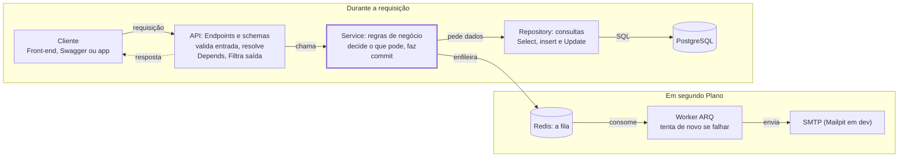
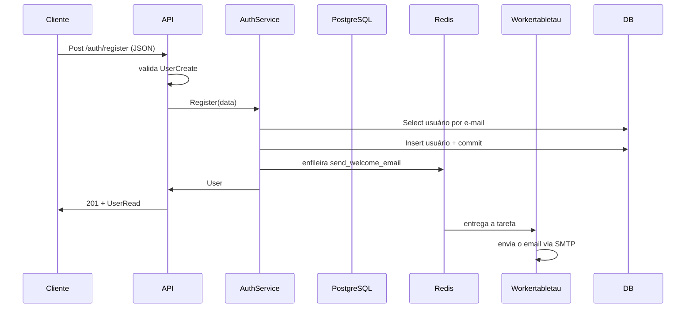

## Guia passo a passo

### Capítulo 1: Criando projeto com o **uv**

acessando o local utilizado para guardar seu projeto execute o comando para a inicialização do projeto

```bash
uv init fastapi-aisiki
```

Assim será criada a estrutura abaixo:

```text
.
├── .git/                       # Metadados e histórico do Git
├── .gitignore                  # Arquivos e pastas que o Git deve ignorar
├── pyproject.toml              # Configurações e metadados do projeto Python
├── .python-version             # Versão do Python desejada para o projeto
├── README.md                   # Documentação inicial do projeto
├── src/                        # Diretório que contém o código-fonte
│   └── fastapi_aisili/         # Pacote Python da aplicação
│       └── __init__.py         # Inicialização e identificação do pacote
└── uv.lock                     # Versões exatas das dependências resolvidas
```

### Capítulo 2: o pyproject.toml e as ferramentas

É um dos arquivos mais importantes do projeto.
Ele concentra metadados, dependências e configurações de ferramentas utilizadas no desenvolvimento.
Por exemplo:

```toml
[project]
name = "fastapi-aisiki"
version = "0.1.0"
description = "API profissional com FastAPI, JWT, PostgreSQL, Redis (filas) e Docker"
readme = "README.md"
authors = [
    { name = "David Luis da Silva", email = "tecnicoroot@gmail.com" }
]

requires-python = ">=3.12"
dependencies = [
    "fastapi>=0.115.0",
    "uvicorn[standard]>=0.32.0",
    "pydantic[email]>=2.9.0",
    "pydantic-settings>=2.6.0",
    "sqlalchemy[asyncio]>=2.0.36",
    "asyncpg>=0.30.0",
    "alembic>=1.14.0",
    "pyjwt>=2.10.0",
    "pwdlib[argon2]>=0.2.1",
    "python-multipart>=0.0.18",
    "arq>=0.26.1",
    "aiosmtplib>=3.0.2",
]

[dependency-groups]
dev = [
    "pytest>=8.3.0",
    "pytest-asyncio>=0.24.0",
    "pytest-cov>=6.0.0",
    "httpx>=0.28.0",
    "mypy>=1.13.0",
    "ruff>=0.8.0",
    "pre-commit>=4.0.0",
]

# ---------------------------------------------------------------- Ruff
[tool.ruff]
line-length = 100
target-version = "py312"
extend-exclude = ["alembic/versions"]

[tool.ruff.lint]
select = [
    "E", "W",   # pycodestyle
    "F",        # pyflakes
    "I",        # isort
    "B",        # bugbear
    "UP",       # pyupgrade
    "N",        # pep8-naming
    "S",        # bandit (segurança)
    "C4",       # comprehensions
    "SIM",      # simplify
    "RUF",      # regras do ruff
    "ASYNC",    # boas práticas async
    "PT",       # pytest
    "T20",      # proíbe print()
]

[tool.ruff.lint.per-file-ignores]
"tests/**" = ["S101", "S105", "S106"]

[tool.ruff.format]
quote-style = "double"

# ---------------------------------------------------------------- Mypy
[tool.mypy]
python_version = "3.12"
strict = true
plugins = ["pydantic.mypy"]
exclude = ["alembic/versions/"]

[[tool.mypy.overrides]]
module = ["asyncpg", "asyncpg.*"]
ignore_missing_imports = true

[tool.pydantic-mypy]
init_forbid_extra = true
init_typed = true
warn_required_dynamic_aliases = true

# ---------------------------------------------------------------- Pytest
[tool.pytest.ini_options]
testpaths = ["tests"]
asyncio_mode = "auto"
asyncio_default_fixture_loop_scope = "function"
addopts = "-ra --strict-markers"

[tool.coverage.run]
source = ["app"]
concurrency = ["greenlet", "thread"]
omit = ["app/scripts/*", "app/worker/settings.py"]

[tool.coverage.report]
show_missing = true
skip_covered = true
```

### Capítulo 3: Antes de começar a codificatr...

Antes de iniciar a codificação vamos entender um pouco melhor as camadas e o fluxo de nossa aplicação.

|Camada |Pasta |Responsabilidade |Não deve saber de...|
|--|--|--|--|
|API(endpoints)|app/api/ Receber HTTP, validar entrada,|devolver resposta|SQL, regras de negócio|
|Schemas |app/schemas/ |Formato dos dados que entram esaem (contratos)|Banco de dados|
|Services |app/services/ |Regras de negócio ("e-mail nãopode repetir")|HTTP, status code|
|Repositories |app/repositories/ |Consultas ao banco (SELECT, INSERT...)|Regras de negócio|
|Models |app/models/ |Tabelas do banco como classes Python|Tudo acima|
|Core |app/core/ |Configuração, segurança,exceções, fila |—|
|Worker |app/worker/ |Tarefas executadas em segundo plano |HTTP|






> Por que isso importa? Imagine que amanhã você precise criar usuários também por um comando de terminal. Como a regra "e-mail não pode repetir" está no service, e não no endpoint, você reaproveita o AuthService sem duplicar nada.

#### O caminho de uma requisição

Quando alguém chama POST /api/v1/auth/register , acontece esta sequência:

> 1. O FastAPI recebe o JSON e o converte num UserCreate (schema). Se o e-mail for
inválido, ele já devolve 422 sem chegar ao seu código.
> 2. O endpoint register pede ao FastAPI um AuthService pronto (injeção de
dependências).
> 3. O service verifica se o e-mail já existe usando o UserRepository .
> 4. O repository executa o SELECT usando a sessão do SQLAlchemy.
> 5. O service cria o User (model), salva com commit() e coloca uma tarefa "enviar e-mail
de boas-vindas" na fila do Redis.
> 6. O endpoint devolve o User , que o FastAPI converte em UserRead (schema de saída),
escondendo a senha.
> 7. Em paralelo, o worker pega a tarefa da fila e envia o e-mail, sem atrasar a resposta. Camada Pasta Responsabilidade Não deve saber de...

### Capítulo 5: Bibliotecas que utilizaremos

Pode ser necessário instalar a versão correta do python:

```bash
uv python install 3.12
uv python pin 3.12
uv sync
```

|Biblioteca |Para que serve|
|--|--|
|fastapi |Framework web: rotas, validação, documentação automática|
|uvicorn[standard] |ServidorASGI que executa a aplicação|
|pydantic[email] / pydantic-settings |Validação de dados e leitura do .env |
|sqlalchemy[asyncio] + asyncpg | ORM e driver assíncrono do PostgreSQL
|alembic |Migrations (versionamento do banco)|
|pyjwt |Criar e validar tokens JWT|
|pwdlib[argon2]| Hash seguro de senhas com Argon2|
|python-multipart |Permite receber formulários (usado no loginOAuth2)|
|arq |Fila de tarefas assíncrona sobre Redis|
|aiosmtplib |Envio de e-mail assíncrono|

### Capítulo 6: Git Cada prefixo tem um papel: Mensagens no commit

Tipos de commit mais utilizados
O Conventional Commits define uma convenção para classificar as alterações.

|Tipo |Quando utilizar| Exemplo|
|--|--|--|
|feat |Adicionar uma funcionalidade	|feat(api): adiciona rota de usuários|
|fix |Corrigir um defeito |fix(api): corrige validação de email|
|docs |Alterar documentação	|docs(readme): documenta instalação do projeto|
|style |Alterações de formatação que não mudam a lógica	|style(api): ajusta formatação do código|
|refactor |Reorganizar o código sem alterar seu comportamento externo |refactor(services): simplifica validação de usuários|
|test |Adicionar ou modificar testes |test(api): adiciona testes para rota de usuários|
|build |Alterar dependências ou o sistema de build |build(deps): adiciona dependência do fastapi|
|ci	|Alterar configurações de integração contínua |ci(github): configura execução dos testes|
|perf |Melhorar o desempenho |perf(api): reduz consultas ao banco de dados|
|chore |Outras tarefas de manutenção |chore(git): atualiza arquivos ignorados|

Agora neste ponto vou fazer o primeiro commit

vamos utilizar o seguinte texto:

```text
chore(project): configura estrutura inicial do projeto
- pyproject.toml
- README.md
```

### Capítulo 7: configuração com pydantic-settings e o .env

Arquivo: app/core/config.py . A regra de ouro é: nada que muda entre ambientes fica
no código. Senha do banco, chave do JWT, endereço do Redis vêm de variáveis de
ambiente, e o arquivo .env é só uma forma prática de defini-las em desenvolvimento.

```text
...
├── src/                        # Diretório que contém o código-fonte
│   └── fastapi_aisili/         # Pacote Python da aplicação
│       ├──__init__.py
        └── core/ 
            └── config.py       # Inicialização e identificação do pacote
...
```

*Settings* herda de *BaseSettings* . Isso significa que, ao fazer Settings() , o Pydantic
procura cada atributo como variável de ambiente com o **mesmo nome**. A ordem de prioridade
é: variável de ambiente real primeiro, depois o arquivo .env , depois o valor padrão
escrito na classe.

#### Repare nos detalhes:

* **Tipos convertem e validam**. POSTGRES_PORT: int faz o texto "5432" do .env virar o número 5432. Se alguém escrever POSTGRES_PORT=abc , a aplicação nem sobe, com uma mensagem clara.
* **Literal[...]** só aceita aqueles valores exatos. Um erro de digitação como ENVIRONMENT=producton é barrado na hora.
* **SECRET_KEY** não tem valor padrão. Por isso ela é obrigatória: se faltar, a aplicação
recusa iniciar. Isso evita subir em produção com uma chave de exemplo.
* **SecretStr** esconde o valor quando impresso. print(settings.SECRET_KEY) mostra
********** , e logs não vazam senhas por acidente. Para usar o valor real, chama-se
.get_secret_value() .
* **extra="ignore"** permite que o .env tenha variáveis que a classe não usa (como
INSTALL_DEV , usada pelo Docker).
* **CORS_ORIGINS: list[str]** é lida como JSON: no .env escreve-se CORS_ORIGINS=
["http://localhost:3000"] .

#### Validação entre campos

```python
@model_validator(mode="after")
def _validate_production(self) -> Self:
    if self.ENVIRONMENT == "production" and
    len(self.SECRET_KEY.get_secret_value()) < 32:

raise ValueError("SECRET_KEY deve ter pelo menos 32 caracteres em produção.")
return self

```

Um model_validator com mode="after" roda depois que todos os campos foram lidos e
validados individualmente. Ele serve para regras que envolvem mais de um campo, como
"em produção, a chave precisa ser longa". Self é o tipo da própria classe.

#### Propriedades calculadas

```python
@property
def database_url(self) -> str:
    return URL.create(
        drivername="postgresql+asyncpg",
        username=self.POSTGRES_USER,
        password=self.POSTGRES_PASSWORD.get_secret_value(),
        host=self.POSTGRES_HOST,
        ...
        ).render_as_string(hide_password=False)

```

Em vez de pedir a URL inteira no .env , montamos a partir das partes. O URL.create do SQLAlchemy cuida de escapar caracteres especiais: se a senha tiver @ ou / , uma
concatenação manual com f-string quebraria a URL. O prefixo postgresql+asyncpg diz
ao SQLAlchemy qual driver usar.

#### Uma instância só: lru_cache

```python
@lru_cache
def get_settings() -> Settings:
    return Settings()
settings = get_settings()

```

Ler o .env e validar tudo tem custo, e não faz sentido repetir. O **@lru_cache** memoriza o retorno: a primeira chamada cria o objeto, as seguintes devolvem o mesmo. O resto do projeto importa settings diretamente.
Um detalhe importante para os testes: como settings é criado no momento do import,o conftest.py precisa alterar os.environ antes de importar qualquer coisa de app.


O .env.example

O .env real fica fora do Git (está no .gitignore ), porque contém segredos. O
.env.example vai para o Git como modelo, com valores falsos e comentários. Quem clona o projeto faz cp .env.example .env e ajusta.
Verificação: se o .env tem POSTGRES_HOST=localhost e o docker-compose.yml define
POSTGRES_HOST: db , qual valor a aplicação usa dentro do container? Por quê?

### Capitulo 8: Banco de Dados assincrono

```text
...
├── src/                        # Diretório que contém o código-fonte
│   └── fastapi_aisili/         # Pacote Python da aplicação
│       ├──__init__.py
        └── db/ 
            ├── base.py  
            └── session.py
...
```

Arquivos: app/db/base.py e app/db/session.py . Aqui definimos a base de todos os models e a forma como a aplicação abre conexões com o PostgreSQL.

#### Antes: o que é "assíncrono"?

Uma consulta ao banco leva alguns milissegundos, e nesse tempo o processador fica
parado esperando a resposta pela rede. Com código síncrono, o servidor fica preso nessa
espera. Com async / await , enquanto uma requisição espera o banco, o mesmo processo
atende outras.
A regra prática: toda operação que espera algo externo (banco, Redis, SMTP, HTTP) é
chamada com await , e só pode ficar dentro de uma função async def . Por isso usamos
bibliotecas assíncronas: asyncpg em vez de psycopg2 , aiosmtplib em vez de smtplib .

Todo model herda de Base . O DeclarativeBase é o mecanismo do SQLAlchemy 2.0 que
transforma uma classe Python em tabela. O metadata é o "catálogo" onde ficam
registradas todas as tabelas; o Alembic lê esse catálogo para gerar migrations.
A naming convention dá nomes previsíveis às constraints. Sem ela, o PostgreSQL inventa
nomes como users_email_key , e para remover essa constraint numa migration futura
você precisaria saber esse nome. Com ela, o nome é sempre uq_users_email .
O type_annotation_map diz: "todo campo anotado como datetime vira TIMESTAMP WITH
TIME ZONE ". Guardar datas com fuso evita o clássico bug de horário que muda entre
servidor e cliente.

#### Mixins: código reutilizável entre models

```python
class UUIDPrimaryKeyMixin:
    id: Mapped[uuid.UUID] = mapped_column(primary_key=True,
default=uuid.uuid4)
class TimestampMixin:
    created_at: Mapped[datetime] = mapped_column(default=utcnow,
server_default=func.now())
    updated_at: Mapped[datetime] = mapped_column(
        default=utcnow, onupdate=utcnow, server_default=func.now()
)
```

Um mixin é uma classe pequena que só existe para ser herdada junto com outras. Em vez
de repetir id , created_at e updated_at em cada model, escrevemos class
User(UUIDPrimaryKeyMixin, TimestampMixin, Base) .

Entendendo a sintaxe do SQLAlchemy 2.0:

* Mapped[uuid.UUID] diz o tipo Python do atributo. O SQLAlchemy deduz o tipo da
coluna a partir dele (UUID vira UUID no Postgres). Se o tipo for str | None , a colunaaceita NULL ; sem None , ela é NOT NULL .
* mapped_column(...) recebe os detalhes da coluna: chave primária, padrão, índice.
* UUID em vez de inteiro sequencial: IDs como 1, 2, 3 revelam quantos usuários
existem e permitem adivinhar o próximo. UUIDs são imprevisíveis.
Por que default=utcnow e server_default=func.now() ? O server_default vai para a
tabela no banco, valendo até para inserts feitos fora da aplicação. O default em Python preenche o valor no objeto antes de salvar. Isso é crucial no modo assíncrono: se só o banco gerasse a data, o SQLAlchemy precisaria fazer uma nova consulta "escondida" para ler o valor, e consultas implícitas são proibidas em código async (gerariam o erroMissingGreenlet ).

#### Engine e sessão

```python
engine = create_async_engine(
    settings.database_url,
    pool_pre_ping=True,
    pool_size=settings.DB_POOL_SIZE,
    max_overflow=settings.DB_MAX_OVERFLOW,
    )
SessionLocal = async_sessionmaker(engine, expire_on_commit=False,
autoflush=False)

async def get_session() -> AsyncIterator[AsyncSession]:
    async with SessionLocal() as session:
        yield session

```

São três peças diferentes, e vale entender a diferença:

* Engine é o gerenciador do pool de conexões. Abrir conexão com o Postgres é caro,
então o engine mantém até 10 abertas ( pool_size ) e cria até 20 extras em picos
( max_overflow ). Existe uma só engine para a aplicação inteira. O pool_pre_ping
testa a conexão antes de usar, evitando erro quando o banco reiniciou.
* SessionLocal é uma fábrica de sessões já configurada.
* Session é a "unidade de trabalho": você adiciona, altera e remove objetos, e no
commit() tudo vai para o banco numa transação. Cada requisição HTTP recebe a sua
própria sessão.

O expire_on_commit=False mantém os dados dos objetos em memória depois do
commit. O padrão ( True ) apagaria esses dados e forçaria uma nova consulta ao acessar
user.email , de novo causando MissingGreenlet em código async.
A função get_session usa yield , o que a torna um gerador. O FastAPI executa o código
até o yield , entrega a sessão ao endpoint, e quando a requisição termina continua
depois do yield . O async with garante que a sessão seja fechada mesmo se der erro.
Verificação: por que existe uma engine para toda a aplicação, mas uma sessão por
requisição? O que aconteceria se duas requisições simultâneas compartilhassem a
mesma sessão?


### Capítulo 9: Os models e o relacionamento N:N

```text
...
├── src/                        # Diretório que contém o código-fonte
│   └── fastapi_aisili/         # Pacote Python da aplicação
│       ├──__init__.py
        └── models/ 
            ├── .py  
            └── .py
...
```


Arquivos em app/models/ . Um model é uma classe Python que representa uma tabela;
cada instância é uma linha. O requisito central aqui é: um usuário pode ter vários perfis, e um perfil pode pertencer a vários usuários. Isso é um relacionamento muitos-para-muitos (N:N).
Por que N:N precisa de uma terceira tabela
Num banco relacional, uma célula guarda um valor só. Não dá para guardar "admin,
financeiro" numa coluna profiles de users sem perder integridade. A solução é uma
tabela de associação, onde cada linha diz "o usuário X tem o perfil Y":

| user_id |profile_id|
|--|--|
|Maria| user|
|Maria| fianaceiro|
|João|user|
|João|admin|

Maria tem dois perfis; o perfil user tem dois usuários. Esse é todo o segredo do N:N.

#### A tabela de associação

```python
user_profiles = Table(
    "user_profiles",
    Base.metadata,
    Column("user_id", ForeignKey("users.id", ondelete="CASCADE"), primary_key=True),
    Column("profile_id", ForeignKey("profiles.id", ondelete="CASCADE"), primary_key=True),
)
```

Note que não é uma classe, e sim um objeto Table . Como ela só liga duas tabelas e não tem dados próprios, não precisa de model. Os pontos importantes:

* **Chave primária composta** ( user_id + profile_id ): o banco impede que o mesmo
perfil seja vinculado duas vezes ao mesmo usuário.
* **ForeignKey** garante que só existam IDs válidos. Não é possível vincular um perfil que não existe.
* **ondelete="CASCADE"**: se um perfil for excluído, as linhas de vínculo somem junto, automaticamente, no próprio banco.

#### O model Profile

__tablename__ define o nome da tabela. unique=True impede dois perfis com o mesmo
nome; index=True acelera buscas por nome. Como description é str | None , a
coluna aceita valor vazio. O __repr__ só define como o objeto aparece ao ser impresso, útil para depurar.

#### O model User

Campo a campo:
* email com 320 caracteres: é o tamanho máximo que a especificação de e-mail
permite.
* hashed_password : nunca guardamos a senha, só o hash. O nome do campo deixa isso explícito para quem lê.
* is_active : permite desativar um usuário sem apagá-lo, preservando histórico.
* is_superuser : um "passe livre" que ignora checagem de perfis.
* token_version : um contador. Cada token JWT carrega o valor atual; ao trocar a senha, o contador sobe e todos os tokens antigos deixam de valer.

#### O relationship: a parte mais importante

profiles não é uma coluna. É um atributo que o SQLAlchemy preenche consultando a
tabela user_profiles . Na prática, você trabalha com uma lista Python comum:

```python
user.profiles.append(perfil_financeiro) # cria uma linha em user_profiles
user.profiles.remove(perfil_admin)      # apaga a linha correspondente
await session.commit()
```

Os parâmetros:
* **secondary=user_profiles** diz qual tabela de associação usar.
* **lazy="selectin"** define quando os perfis são carregados. O padrão ( lazy="select" ) carrega só ao acessar user.profiles , mas em código async esse carregamento tardio é proibido e gera erro. Com selectin , ao buscar usuários o SQLAlchemy faz logo em seguida um segundo SELECT ... WHERE user_id IN (...) trazendo os perfis de todos de uma vez. São duas consultas no total, mesmo para 100 usuários, evitando o famoso problema N+1.
* **order_by=Profile.name** devolve os perfis sempre em ordem alfabética, o que torna respostas e testes previsíveis.
O método has_any_profile("admin", "gerente") usa *names para aceitar qualquer
quantidade de argumentos. A expressão any(...) retorna True assim que encontra o
primeiro perfil que bate. Colocar esse método no model mantém a lógica perto dos dados.

#### O model PasswordResetToken

Cada pedido de "esqueci minha senha" cria uma linha aqui. expires_at limita a validade; used_at marca quando foi usado, garantindo uso único. Guardamos token_hash (64 caracteres de um SHA-256) e não o token: se o banco vazar, os hashes não servem para redefinir senha de ninguém.

#### O arquivo __init__.py dos models

Esse arquivo parece inofensivo, mas é essencial. Uma tabela só entra no Base.metadata quando o módulo dela é importado. O Alembic faz from app import models , e esse __init__.py garante que todas as tabelas sejam registradas. Esquecer um import aqui faz o Alembic achar que a tabela não existe.
Verificação: o que acontece no banco quando você faz user.profiles.append(p) e
depois commit() ? Por que lazy="selectin" e não o padrão?